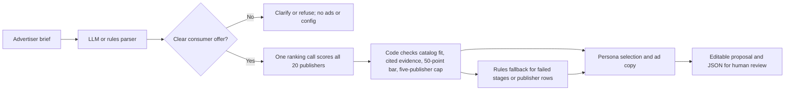

# Production ranking, bidding, and pacing plan

## Executive decision

The supplied catalog has 20 publisher records but no impression, click, conversion, auction, spend, or margin history. The current CPA and CPM values are planning heuristics, not trained bids or performance forecasts. There is no honest way to train a conversion model or claim campaign lift from this data.

Keep the current app in **proposal mode**. Use an LLM during campaign setup to structure the brief, explain matches, and draft creative. Enforce eligibility, evidence, budget caps, and safety in code. When delivery data exists, use a fast prediction service and deterministic serving controls; do not call an LLM for every impression.

The current synthetic logistic reranker did not beat the hand-tuned score (66.2% vs. 66.8% held-out P@5 over grouped folds). Those labels are subjective catalog judgments, so this result is only a baseline diagnostic. The 45-brief GPT/rules refusal results are development-set measurements, not independent accuracy evidence. Details and limitations are in [`ML_EXPERIMENTS.md`](ML_EXPERIMENTS.md) and the evaluation reports.

## What the prototype does today



For a 20-row catalog, one ranking call gives every publisher a reviewable score and reason without an API call per publisher. Code derives `shelf` / `audience` / `none` fit from catalog taxonomy, rejects publishers with no fit, validates evidence, applies the 50-point threshold, and caps buys at five. Model output cannot override those gates. Each response is labeled as model, rules, or hybrid; the UI exposes publisher-level model/rules differences.

The config editor currently exposes monthly pacing budget, flight length, target CPA, learning days, frequency cap, and attribution window. Its publisher mix remains automatic. The default mix is proportional to `score² × log10(monthly impressions)` and limits any one publisher to 70% when more than one publisher is recommended. The UI calculates the total flight budget from monthly pace and flight duration. The CTR prior is visible for measurement planning only; it does not affect bids or budget.

## Production architecture

Keep campaign setup and impression serving as separate paths:

1. **Setup path:** LLM parses the advertiser brief and drafts copy; deterministic policy validates product eligibility and advertiser constraints; retrieval returns candidate publishers; a ranker scores candidates; a reviewer approves the plan.
2. **Serving path:** A low-latency, versioned prediction service scores only eligible candidates. The auction and pacing controller apply the campaign's remaining budget, bid ceiling, publisher limits, and kill switch. Model failure falls back to safe deterministic behavior.
3. **Feedback path:** Impression, auction, click, conversion, cost, and margin events are joined after attribution matures. Monitoring and training consume the same versioned feature definitions used by serving.

An LLM may explain a setup-time recommendation with catalog evidence. It should not decide real-time auction eligibility or issue an impression-level bid.

## Ranking and training data

### Candidate selection

Apply eligibility rules before ranking: product and publisher policy, actual inventory, geography, brand safety, contract status, advertiser blocks, and available budget. For a large catalog, use a high-recall retrieval step over the normalized product brief and publisher descriptions. Then rerank the eligible publisher/placement pairs with a calibrated tabular baseline. Useful features include product core, context, audience cohort, explicit demographic overlap, price/AOV compatibility, reach, placement characteristics, historical conversion value, and uncertainty. Keep direct-shelf fit distinct from adjacent-audience fit.

Start with logistic regression and compare with a gradient-boosted tree only after the labels and evaluation split are trustworthy. Do not use the synthetic baseline weights in serving. With the current inputs, there is no campaign-outcome label to train on, and synthetic “good/bad match” labels can only show that the pipeline works.

### Instrumentation before training

Record the eligible candidate set, not just the winning publisher. A useful event contract includes:

- event, campaign, advertiser, publisher, placement, and impression IDs;
- event time, placement/context, device and allowed audience features;
- eligibility outcome and reason, selected rank, selection propensity, and model/rules version;
- bid, floor, win/loss, clearing price, served impressions, and actual spend;
- deduplicated clicks and conversions, attribution window, conversion time, order value, contribution margin, refunds, and cancellations.

Define labels before training. CTR is clicks divided by valid impressions; CVR should state whether the denominator is impressions or clicks. Join conversions only after the attribution window matures. Do not use clicks as a substitute label for purchase value. Apply consent, retention, and data-minimization rules to event collection.

Use time-based holdouts to reflect future traffic. Log selection propensity and candidate position so evaluations can account for selection and position bias. Check calibration, ranking quality, segment stability, margin-adjusted value, and incremental lift. A random split across impressions can leak campaign or time context and overstate quality.

## Bidding and campaign economics

For a purchase campaign, an upper-bound eCPM from a target CPA and conversion probability is:

```text
max eCPM = target CPA × conversions per impression × 1,000
```

For example, a $30 target CPA and a conversion probability of 0.001 per impression imply a $30 eCPM ceiling before win-price, margin, and risk adjustments. A production bidder also estimates win probability and clearing price and applies bid shading where the auction requires it. Add uncertainty-aware bid limits and a hard advertiser cap.

Set target CPA from contribution margin and advertiser goals, not AOV alone. Subtract product cost, fulfilment, discounts, payment fees, expected returns, and other variable costs before determining an allowable acquisition cost. The prototype's category percentages of stated/assumed order value are placeholders and must be replaced by buyer-supplied economics.

The prototype sets an initial CPM near 45% of the CPA cap, uses a seven-day learning phase, and clamps that value to a small fixed range. These are cold-start settings only. The displayed 0.5% CTR prior is `Beta(1, 199)` and has a helper for aggregate clicks/impressions; no event stream is connected and the prior does not feed the bidder. A real prior should be selected for a defined population and updated with mature, representative observations.

## Budget allocation and pacing

The prototype starts from a price-tier budget, scales it by recommended publisher count, then allocates by fit score and reach. This is easy to inspect but cannot predict outcomes. The synthetic response-curve script demonstrates fitting diminishing returns and allocating a fixed budget; its generated conversions and ROAS are not measurements and must not be used as real budget guidance.

Once publisher-level conversion value is observed, begin with small exploration budgets and compare marginal expected contribution per dollar. A contextual bandit such as Thompson sampling can balance exploration and exploitation while respecting minimum tests and maximum-share limits. Wait for attribution to mature before moving large budget amounts.

Enforce a hard lifetime budget, a daily limit, per-publisher caps, and a kill switch. Define a target spend curve over flight days. Every few minutes, compare target cumulative spend with actual spend; a bounded PI controller can adjust a delivery multiplier. Clamp each change, honor remaining budget, and stop at the hard cap. Reconcile with the billing ledger and alert on overspend risk, underspend, stale conversion data, drift, and service failures.

## Evaluation and safe rollout

1. **Proposal mode (current):** Keep the app human-reviewed. Validate refusal cases, claims, publisher evidence, config math, latency, fallback behavior, and cost. Treat the 45-brief quality scores as development diagnostics; prompts and rules were iterated using that set.
2. **Adjudicated labels:** Create a separate, reviewed brief/publisher set with explicit positive, negative, and unknown judgments. Keep a brief-level and time-based holdout untouched during prompt/model changes.
3. **Shadow ranking:** Collect real events and score eligible candidates without changing delivery. Verify logging, feature parity, calibration, segment quality, and budget calculations.
4. **Controlled test:** Run a small experiment with a human operator, predeclared quality and margin gates, hard spend caps, and an online holdout. Promote only after incremental value and safety gates pass.

The current app does not implement the event pipeline, a trained conversion model, a real-time auction bidder, a spend controller, login, or a campaign-launch action. Hosted deployment should keep the OpenAI key server-side, add request limits, and set a provider spend limit before broad sharing.
